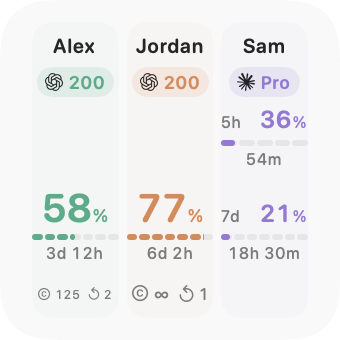
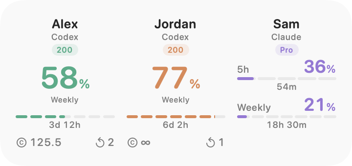

# Claude and Codex Usage Viewer

Native macOS app and widgets for one to three accounts in any mix of Claude and Codex: usage remaining, reset countdowns, and provider-specific resources.

[Download](https://github.com/schneidermayer/claude-and-codex-usage-viewer/releases/latest) · Requires macOS 27+ and the CLI for each provider you use: [Claude Code](https://code.claude.com/docs/en/setup) or [Codex](https://learn.chatgpt.com/docs/codex/cli). This README describes the current source; [release notes](https://github.com/schneidermayer/claude-and-codex-usage-viewer/releases) describe published builds. Earlier releases retain their original names.

<picture>
  <source media="(prefers-color-scheme: dark)" srcset="docs/images/widget-small.png">
  
</picture>
<picture>
  <source media="(prefers-color-scheme: dark)" srcset="docs/images/widget-large.png">
  
</picture>

*Layout previews with sample accounts.*

## Setup

1. Unzip the download and move the app to Applications.
2. Choose Claude or Codex for the first account, then sign in through its browser profile. If Claude displays an authentication code, paste the complete code into the app’s **Authentication code** field and choose **Submit code**. Use **Add account** for up to three accounts in any combination; remove accounts from their options menu.
3. In **Edit Widgets**, add **Small** (square) or **Large** (wide).

Upgrading from Codex Usage Viewer: quit and remove the old app bundle from Applications before installing the renamed app. Account connections remain in their existing storage. If existing desktop widgets keep showing old data after the rename, log out of macOS and back in, or restart, to clear the cached old app location.

Select the appropriate Claude or Codex executable in Settings if detection fails. Change an account’s provider after disconnecting it. At least one account remains configured.

A login helper refreshes every three minutes, including after quitting. Allow or disable it in **System Settings → General → Login Items & Extensions**; connection status appears in app Settings. macOS controls widget refresh timing.

The dashboard shows each reported limit in its own panel with usage remaining and a reset countdown. Widgets adapt to one to three accounts and show both five-hour and weekly limits when reported, with a separate reset bar and countdown for each. Small widgets label a pair of limits **5h** and **7d**; the bars track time until reset, not usage. Weekly-only accounts keep a larger percentage. The computer marks the local Codex account; Ⓒ marks Codex credits and ↶ earned resets. Earned resets are separate from automatic resets. Codex Prolite/Pro/Promax display as 100/200/500; Claude plan names remain unchanged.

Small widgets align the weekly figures, reset bars, and countdowns across subtly shaded account columns. The provider icon sits beside the subscription, and credits and earned resets share one row. Credit balances use short forms such as **7.1k** and **71k**, rounded down; full values remain available in tooltips and accessibility labels.

Missing data, expired limits, and data older than ten minutes are unknown. Widgets use compact resource values, — for unknown, and ∞ for unlimited credits; full identities and exact values remain available to accessibility and in tooltips. A reset timestamp never proves quota recovery.

## Build and test

Requires Xcode. Configure signing, team, and App Group for the app, helper, and widget in `CodexUsageViewer.xcodeproj`.

```sh
./scripts/build.sh
swift test
python3 scripts/test_version.py
./scripts/render_widgets.sh
xcodebuild -project CodexUsageViewer.xcodeproj -scheme CodexUsageViewer \
  -configuration Debug -derivedDataPath build -destination 'platform=macOS' test
```

Output: `build/Build/Products/Release/Claude and Codex Usage Viewer.app`.

Tests and renders use fixtures; verify live accounts and desktop widget hosting separately.

After adding sources, run `ruby scripts/generate_project.rb` (requires the `xcodeproj` gem).

## Releases

Update `VERSION` and `docs/releases/<version>.md`, validate, and commit. From a clean tree:

```sh
release_version=$(cat VERSION)
python3 scripts/release.py "$release_version" --notes "docs/releases/$release_version.md"
```

Notarization uses the existing Keychain profile named in [Config/notary-profile.txt](Config/notary-profile.txt), currently `emoji-picker-macos-notary`. Set `NOTARY_PROFILE` to override it on another Mac.

Publishes a signed, notarized universal ZIP and checksum. Tagged builds display `VERSION`; development builds append commits since the nearest numeric release tag. Never move a published tag.

## Privacy

Codex credentials stay in private app-owned `CODEX_HOME` directories under `~/Library/Application Support/CodexUsageViewer/Accounts/account-{1,2,3}`. Claude uses separate app-owned `CLAUDE_CONFIG_DIR` directories and the CLI’s directory-scoped credential storage. Never copy, log, or commit credentials. Widgets receive sanitized snapshots; Chrome cookies are not read.

Uses [Codex app-server](https://learn.chatgpt.com/docs/app-server#auth-endpoints) account methods without inference. The default local identity is read through `account/read`, without login, logout, or token refresh. Names come only from app-owned logins matched to the official account email, with email fallback.

Claude sign-in and identity use Claude Code’s [authentication commands and isolated account directories](https://code.claude.com/docs/en/authentication#log-in-with-multiple-accounts), requiring version 2.1.268 or later. Token renewal uses the CLI’s [refresh-token environment variables](https://code.claude.com/docs/en/env-vars). Usage is read from Anthropic’s OAuth usage endpoint using only that account’s app-owned credentials. This usage endpoint is not a documented stable public API; unavailable or changed responses remain unknown. The app never reads the normal Claude account’s credentials.

The app keeps its original bundle identifiers and storage paths so existing Codex sign-ins, preferences, and desktop widgets survive the rename. Legacy three-account configurations are preserved; new installations start with one account.
