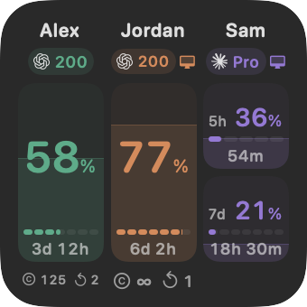
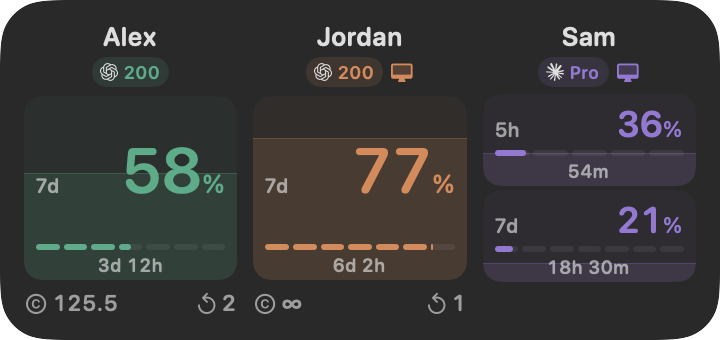

# 2.2

- Make widget columns show remaining usage with subtle fills that start below the provider and subscription row. Accounts with both five-hour and weekly limits get two equally sized bars.
- Reduce widget padding, enlarge single-limit percentages, and align reset tracks and countdowns. Keep provider icons, subscription badges, and local-account indicators together below each name.
- Show horizontal usage fills in the main window, with equal-sized limit panels and the exact weekly reset date below them.
- Detect the default local Claude account through the CLI's read-only authentication status. Show **Logged In** beside its subscription in the app and a computer icon in widgets, just as for local Codex accounts. Matches expire when identity checks become stale.
- Update the Small and Large widget screenshots in light and dark appearances.

Quit and replace the app in Applications; account connections are preserved. Requires macOS 27 or later and the CLI for each provider you use. The signed and notarized download supports Apple silicon and Intel Macs.

Widget previews with sample accounts:

