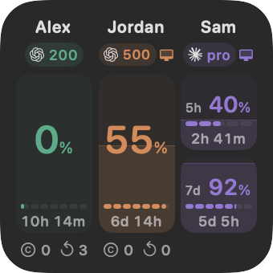
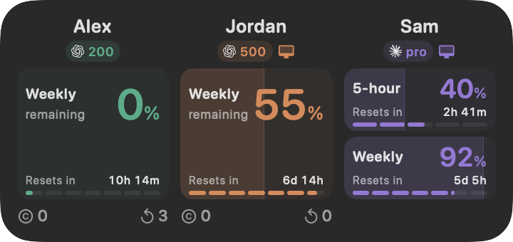
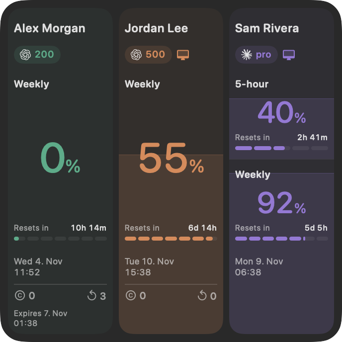

# 2.3

- Add a third widget, **Dashboard**, with tall account columns, large percentages, and aligned reset dates, Codex resources, and reset expiry details.
- Make Dashboard's vertical usage fills the background of each account column. Five-hour and weekly limits have independent sections, without nested boxes around the content.
- Give the wide **Large** widget horizontal usage fills, with numeric reset countdowns above the reset tracks.
- Preserve **Small**'s compact vertical layout. Keep provider icons, subscription badges, and computer icons for confirmed local accounts in all three widgets.
- Refresh the screenshots for all three widgets in light and dark appearances, using sample accounts.

Add the new Dashboard widget from the macOS widget gallery. The main app dashboard is unchanged.

Quit and replace the app in Applications; account connections are preserved. Requires macOS 27 or later and the CLI for each provider you use. The signed and notarized download supports Apple silicon and Intel Macs.

Widget previews with sample accounts:

<picture>
  <source media="(prefers-color-scheme: light)" srcset="https://raw.githubusercontent.com/schneidermayer/claude-and-codex-usage-viewer/2.3/docs/images/widget-small-light.png">
  
</picture>

<picture>
  <source media="(prefers-color-scheme: light)" srcset="https://raw.githubusercontent.com/schneidermayer/claude-and-codex-usage-viewer/2.3/docs/images/widget-large-light.png">
  
</picture>

<picture>
  <source media="(prefers-color-scheme: light)" srcset="https://raw.githubusercontent.com/schneidermayer/claude-and-codex-usage-viewer/2.3/docs/images/widget-dashboard-light.png">
  
</picture>
